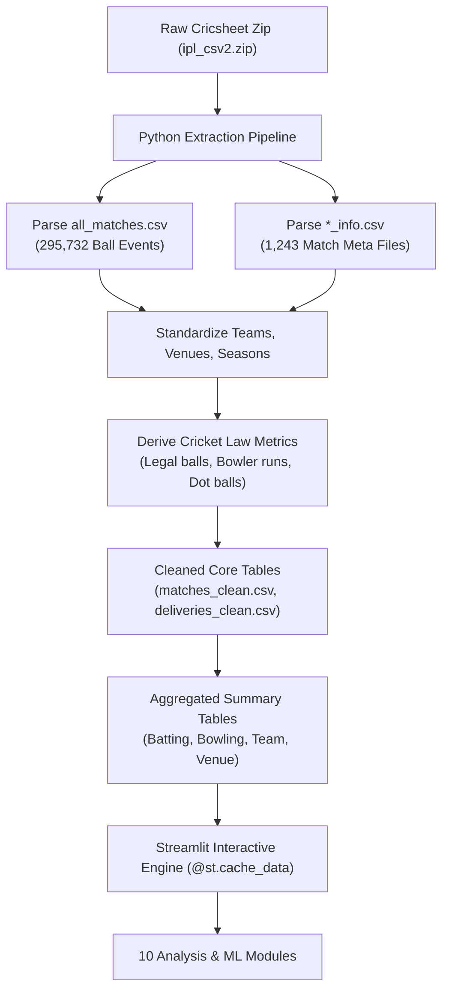

# ANALYTICAL METHODOLOGY & MATHEMATICAL FORMULATIONS

## 1. DATA PROCESSING PIPELINE ARCHITECTURE

---

## 2. MATHEMATICAL & STATISTICAL FORMULATIONS

### 2.1 Batting Metrics

1. **Batting Strike Rate ($\text{SR}$):**
   $$\text{SR} = \left(\frac{\text{Total Runs Scored}}{\text{Balls Faced (Excluding Wides)}}\right) \times 100$$

2. **Batting Average ($\text{Avg}$):**
   $$\text{Avg} = \begin{cases} \frac{\text{Total Runs Scored}}{\text{Number of Dismissals}}, & \text{if Dismissals} > 0 \\ \text{Total Runs Scored}, & \text{if Dismissals} = 0 \end{cases}$$

3. **Boundary Percentage ($\text{BP}$):**
   $$\text{BP} = \left(\frac{(4 \times N_4) + (6 \times N_6)}{\text{Total Runs Scored}}\right) \times 100$$

4. **Player Consistency Index ($\text{PCI}$):**
   Evaluates how predictably a player scores near their expected mean:
   $$\text{PCI} = \max\left(0, 100 - \left(\frac{\sigma_{\text{runs}}}{\mu_{\text{runs}}} \times 100\right)\right)$$
   where $\sigma_{\text{runs}}$ is the standard deviation of innings scores and $\mu_{\text{runs}}$ is the mean innings score.

5. **Batting Efficiency Rating ($\text{BER}$):**
   $$\text{BER} = 0.40 \cdot \text{Norm}(\text{Avg}) + 0.40 \cdot \text{Norm}(\text{SR}) + 0.20 \cdot \text{Norm}(\text{BP})$$
   where $\text{Norm}(x) = \frac{x - x_{\min}}{x_{\max} - x_{\min}} \times 100$.

---

### 2.2 Bowling Metrics

1. **Bowling Economy Rate ($\text{Econ}$):**
   $$\text{Econ} = \frac{\text{Bowler Runs Conceded}}{\left(\frac{\text{Legal Deliveries Bowled}}{6}\right)}$$
   *Note: In accordance with MCC Laws, bowler runs include runs off bat, wides, no-balls, and penalties, while excluding byes and leg-byes.*

2. **Bowling Average ($\text{BA}$):**
   $$\text{BA} = \frac{\text{Bowler Runs Conceded}}{\text{Wickets Taken by Bowler}}$$

3. **Bowling Strike Rate ($\text{BSR}$):**
   $$\text{BSR} = \frac{\text{Legal Deliveries Bowled}}{\text{Wickets Taken by Bowler}}$$

4. **Bowling Efficiency Rating ($\text{BoER}$):**
   $$\text{BoER} = 0.40 \cdot \text{InvNorm}(\text{Econ}) + 0.35 \cdot \text{InvNorm}(\text{BA}) + 0.25 \cdot \text{InvNorm}(\text{BSR})$$
   where $\text{InvNorm}(x) = \frac{x_{\max} - x}{x_{\max} - x_{\min}} \times 100$ (lower metric yields higher efficiency).

---

### 2.3 Hypothesis Testing: Toss Impact Analysis
- **Test:** Goodness-of-Fit Pearson's Chi-Square ($\chi^2$) Test.
- **Null Hypothesis ($H_0$):** Winning the toss has no correlation with match outcome ($p = 0.50$).
- **Alternative Hypothesis ($H_1$):** Toss confers a significant strategic advantage ($p \ne 0.50$).
- **Test Statistic:**
  $$\chi^2 = \sum \frac{(O_i - E_i)^2}{E_i}$$
  with degrees of freedom $df = 1$. The test evaluates whether observed toss-match win ratios diverge significantly from expected random outcome distributions at $\alpha = 0.05$.

---

### 2.4 Machine Learning Win Prediction Model

1. **Target Formulation:**
   Binary classification:
   $$y \in \{0, 1\} \quad \text{where } 1 = \text{Team 1 Wins}, \, 0 = \text{Team 2 Wins}$$
2. **Feature Space:**
   - $\mathbf{x}_{\text{pre}} = [\text{Team 1}, \text{Team 2}, \text{Venue}, \text{Toss Winner}, \text{Toss Decision}]$
   - $x_{\text{mid}} = \text{Innings 1 Runs Total}$
3. **Model Pipeline:**
   - One-Hot Categorical Encoding for nominal variables.
   - Regularized Logistic Regression:
     $$\hat{P}(y=1 \mid \mathbf{x}) = \frac{1}{1 + e^{-(\mathbf{w}^T \mathbf{x} + b)}}$$
   - L2 Ridge penalty with inverse regularization strength $C=0.5$.
4. **Data Splitting & Leakage Mitigation:**
   - 80% Stratified Training Set, 20% Holdout Testing Set.
   - Exclusion of post-match statistics (margin, wickets in second innings, player of match) to prevent temporal data leakage.

